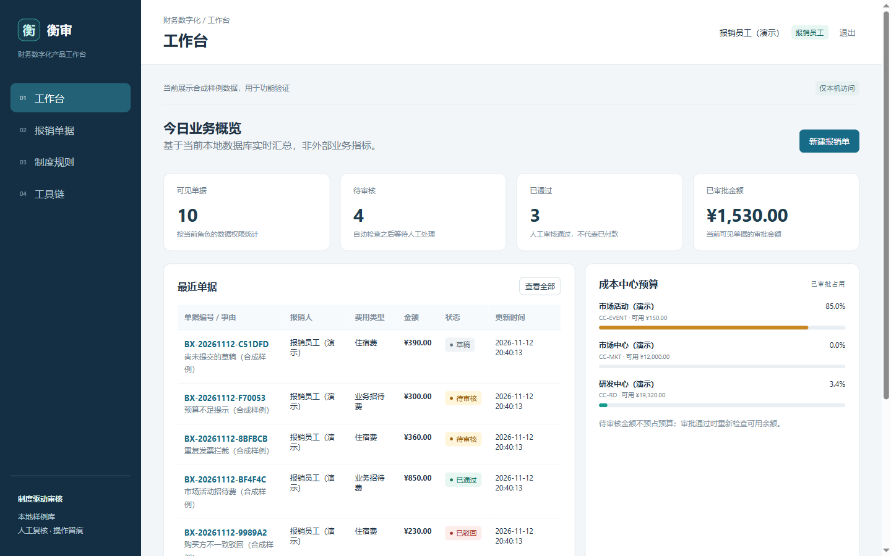

# 衡审｜财务制度与单据智能审核

面向**数字化财务产品经理**的可运行作品集项目：把制度版本、单据字段、成本中心预算、人工审批和审计证据串成一条本地业务闭环。



> 当前为本地合成数据演示，不是企业实际部署，不提供真实用户满意度或效率提升结论。不调用 MinerU API，不调用大模型 API，不自动付款或入账。

## 功能

- **中文业务审批流**：草稿、待审核、退回补充、已通过、已驳回；退回后可修改并重新提交。
- **服务端角色权限**：报销员工、财务审核、制度管理员、审计查看，各自具有不同的操作与数据范围。
- **制度版本管理**：结构化 DSL / JSON 导入、草稿预览、管理员确认发布；历史单据保留使用的制度版本。
- **可解释规则引擎**：必填、购销主体、日期、城市分档限额、有效流程查重、预算、单据字段一致性及人工复核警告。
- **预算与会计对象**：成本中心预算和审批占用；按费用类型生成借贷建议分录，明确 `posted=false`，没有真实过账。
- **本地文档导入**：TXT、MD、CSV、JSON、DOCX、PDF、常见图片和已有 MinerU JSON。
- **离线中文 OCR**：Windows 自带中文识别；行位置重组、原图本地预览、人工修正确认与原始文本留存。
- **工具链与审计**：统一注册城市、日期、预算、科目建议、发票查重工具；记录输入、输出、耗时、成功状态及操作日志。
- **CSV 导出**：本人或授权范围内的单据、审计记录；UTF-8 BOM 及公式注入防护。

产品对象、流程、权限与边界详见 [产品说明](docs/product-spec.md)。

## 本地启动

需要 Python 3.11+，当前已在 Windows + Python 3.13 实际运行。

```bash
python -m pip install -r requirements.txt
python app.py --demo --port 8080
```

打开 **http://127.0.0.1:8080**。首次使用 `--demo` 创建合成数据，重复启动不会覆盖已有记录。数据保存在 `var/finance_audit.db`，该目录已被 `.gitignore` 排除。

| 角色 | 用户名 | 演示密码 |
|---|---|---|
| 报销员工 | `employee` | `demo123` |
| 财务审核 | `finance` | `demo123` |
| 制度管理员 | `admin` | `demo123` |
| 审计查看 | `auditor` | `demo123` |

密码使用 PBKDF2 哈希存储，会话有效期 8 小时。默认密码只用于本机样例，不能直接用于生产。**登录页不预填账号或密码，也没有一键登录按钮**，请手动输入上表凭据。

管理员可以在“账号与权限”页面创建、启用或停用账号，并新增成本中心。停用账号会同时撤销其现有会话。连续 5 次登录失败后，同一来源和账号会触发 60 秒限流；修改类 API 还会校验同源 Origin 与请求体大小。

## 无样例数据的初始化

如果需要空白的本地业务库，而不是合成样例，请不要使用 `--demo`。在 PowerShell 中执行：

```powershell
cd D:\finance-audit-agent
python app.py --init-only
python app.py --port 8080
```

首次初始化会在终端要求设置管理员密码，至少 12 位且同时包含字母和数字。随后以管理员身份登录，创建实际使用账号与成本中心，再导入并发布自己的制度。此路径**不会写入样例单据、样例制度或预置演示账号**。

自动化初始化可使用 `FINANCE_AUDIT_ADMIN_PASSWORD` 环境变量，避免在命令行参数中留下密码。当前仍是本机应用，不代表已经完成企业级安全审计。

## 推荐体验路径

1. 使用员工账户进入“新建报销单”，选择 `examples/invoice.json` 或 `examples/demo_invoice.png`。
2. 核对导入字段。OCR 可能误识别字母、数字或标签，必须对照原图修正；保存时会记录字段确认。
3. 提交后查看逐项规则、制度版本、工具调用和会计建议分录。
4. 切换 `finance` 处理待审核单据，尝试超额通过、退回补充和正常通过。
5. 切换 `admin` 导入制度、确认发布或调整预算；切换 `auditor` 查看并导出审计日志。

示例制度已自动发布为 v1.0。页面再次导入同名同版本会被拒绝，请先修改版本号。重复使用同一发票代码与号码可用于验证查重拦截。

## 规则配置

项目使用明确的结构化规则，不把任意自然语言制度包装成可靠的自动规则抽取。`examples/travel_policy.txt` 展示了可读 DSL：

```text
[HOTEL_CITY_CAP]
名称=住宿费城市分档限额
费用类型=住宿费
检查字段=amount_cents
操作=city_cap
值={"一线": 600, "二线": 500, "其他": 400}
级别=error
提示=住宿金额超过该城市等级的制度限额
```

金额在数据库中以整数分存储。所有阻断项必须解决，警告项通过时必须填写人工复核理由。

## 本地工具与 MCP

Web 端“工具链”页面可直接调用城市、日期和预算工具。标准输入输出服务使用同一工具注册表：

```bash
python -m finance_audit.mcp_server
```

通过 MCP 客户端连接，支持 `initialize`、`tools/list`、`tools/call` 和 `ping`。已实际完成握手、工具列表及城市查询调用；这是本地只读工具的有限实现，不是完整 MCP 平台。

## 实际验收

- 真实 HTTP 端到端验收通过 **15 组场景**：登录与角色权限、正常审批、超额拦截、退回修改、重复发票、未来日期、预算调整、制度新旧版本、人工确认、导出及退出登录。
- 非示例初始化、管理员创建/停用账号、弱密码与重复账号拒绝、Origin 校验和登录限流均已实测；另完成 **40 个并发读取请求**，验证 SQLite 与 FastAPI 线程池兼容性。
- 浏览器验证手动输入账号密码登录，无预填或一键进入；管理员实际创建并停用账号。
- 浏览器实际选择 `invoice.json`、修改合成发票号码并提交；附件关联和字段一致性成功，12 项适用检查全部通过。
- 实际识别合成 PNG：Windows 中文 OCR 已跑通；识别错误字段经人工修正后保存，未虚构 OCR 准确率。
- 实际解析带中文字体的 PDF、DOCX 制度文件、普通 JSON 和已有 MinerU `content_list` JSON，全程无 MinerU API 调用。
- 验收使用独立数据库，结束后清理临时脚本和测试库，不污染默认演示库。

## 项目结构

```text
app.py                       # 本地启动、样例或空白库初始化
finance_audit/
  bootstrap.py               # 空白库、管理员与基础科目初始化
  web.py                     # FastAPI、会话与权限、REST API、CSV 导出
  services.py                # 单据状态机、审批、预算与查询
  rules.py                   # 规则执行与评测留痕
  policies.py                # 制度 DSL / JSON、草稿与版本发布
  documents.py               # 文档适配、字段提取与人工确认
  ocr.py                     # 本地 OCR 调用
  tools.py                   # 工具注册与调用日志
  mcp_server.py              # 本地 MCP 工具服务
  db.py / security.py        # SQLite、事务、审计、密码与会话
static/                      # 中文原生 HTML/CSS/JavaScript 工作台
scripts/windows_ocr.ps1      # 固定项目脚本，进程级执行豁免
examples/                    # 明确标注的合成制度与单据
docs/product-spec.md         # 产品对象、流程与边界
```

## 边界

- 仅监听 `127.0.0.1`，没有企业生产所需的 SSO、TLS、备份、合规评估和正式财务系统连接。
- 会计分录只是科目映射建议，没有真实凭证，不触发银行、税务或 ERP 操作。
- 图片 OCR 依赖 Windows 中文识别器；无文本 PDF 仅 OCR 首页，不宣称复杂票据的全量识别能力。
- 合成样例不是实际用户试用，不用于证明效率提升或业务收益。
- 参考 [jshERP](https://github.com/jishenghua/jshERP)、[ERPNext](https://github.com/frappe/erpnext)、[AuditAgent](https://github.com/megemini/AuditAgent) 的业务场景与设计思路，未复制其完整系统或声称替代其功能。
